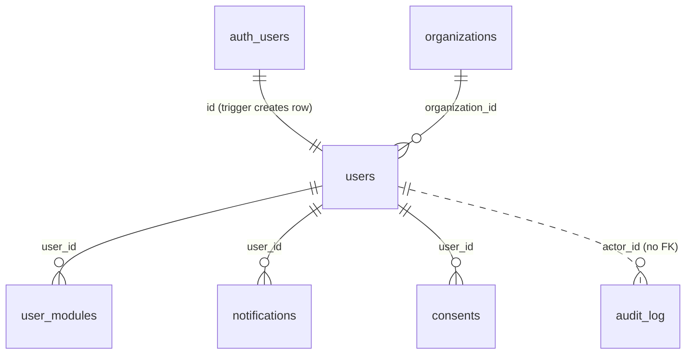
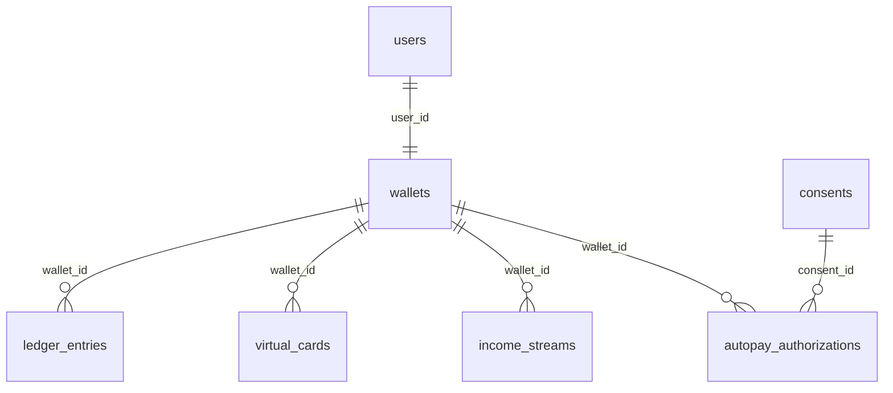
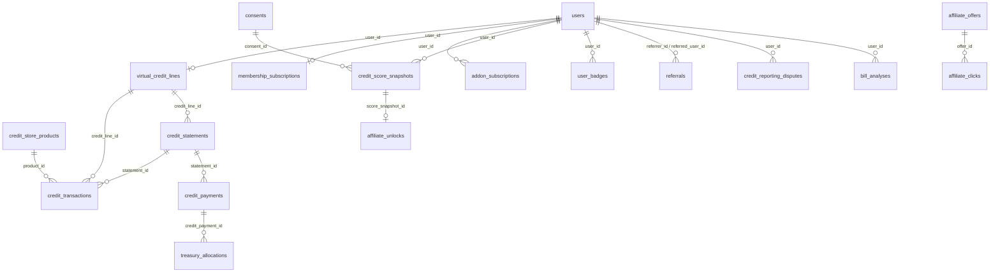
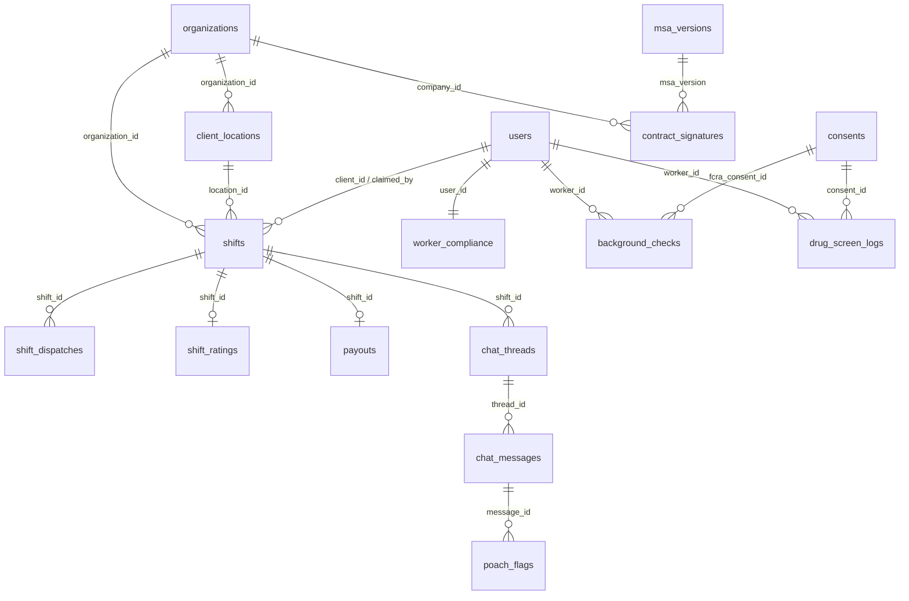
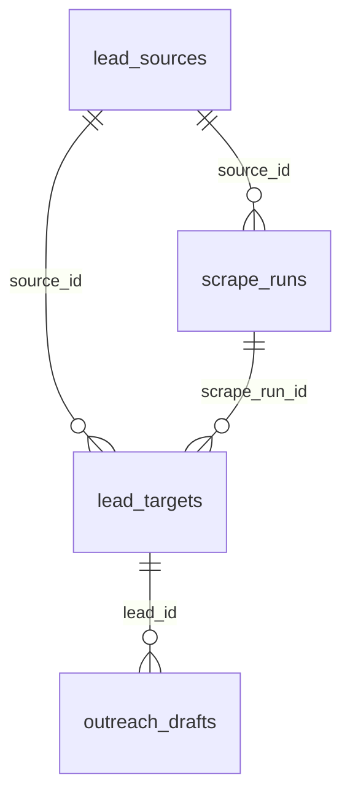

# EzWerkz data model

Source of truth: `supabase/migrations/0001…0005`. This page explains how the
schema fits together, which RPCs exist and who may call them, and how Row Level
Security (RLS) is arranged. Apply/seed instructions are in
[`supabase/README.md`](../supabase/README.md).

**Conventions**

- Every table lives in `public`, has a `uuid` primary key (`gen_random_uuid()`),
  `created_at timestamptz default now()`, and RLS **enabled with explicit policies**.
- Money is `bigint` cents (`*_cents`). Rates, fees and splits come from
  `platform_config`, a key/value mirror of `src/lib/pricing.ts`.
- Locations are PostGIS `geography(Point,4326)` (`users.home_geo`, `shifts.geo`,
  `client_locations.geo`). Each has plain `lat`/`lng` (`home_lat`/`home_lng`)
  columns kept in sync by trigger, so app code can write either form and read
  coordinates without parsing EWKB.
- snake_case columns map to the camelCase fields in `src/lib/types.ts`
  (e.g. `hourly_pay_rate_cents` → `hourlyPayRateCents`).
- Internal helpers and trigger functions live in the `private` schema, which the
  Data API does not expose.

---

## 1. Core (0001)



| Table | Purpose / key columns |
|---|---|
| `organizations` | Client companies. `kind = 'client_company'`, billing contact, `stripe_customer_id`. |
| `users` | 1:1 with `auth.users`. `role` (`member` · `worker` · `client_manager` · `admin`), `organization_id`, `phone_e164` (unique), `home_geo`/`home_lat`/`home_lng`, `sms_opt_in` + `sms_opt_in_at` (required when opted in) + `sms_opt_out_at`, `referral_code`. |
| `user_modules` | Which doors a user entered: `credit` · `wallet` · `shifts` (unique per user). |
| `platform_config` | `key` → `value jsonb` (rates, split, thresholds, `impact_partner_name`, `credit_due_timezone`). Changes are audited. |
| `notifications` | In-app inbox (`kind`, `title`, `body`, `link_href`, `data`, `read_at`). |
| `audit_log` | **Append-only.** `actor_id`, `action`, `entity_type`, `entity_id`, `details`. |
| `consents` | `kind` (`fcra_disclosure` · `drug_screen` · `sms` · `autopay` · `soft_pull` · `esign`), `text_version`, server-stamped `accepted_at`, `ip_address`, `user_agent`, `revoked_at`. Only `revoked_at` may change (once); rows cannot be deleted. |

Sign-up trigger (`auth.users` insert) creates the `users` row with role
**`member`** (metadata can set `full_name`, never a role), the `credit` + `wallet`
modules, and a wallet. An `sms` consent sets `sms_opt_in`; opting out (STOP,
toggle, phone change) revokes active `sms` consents. A new phone number drops an
existing opt-in (TCPA consent is per number).

## 2. Wallet — Module B (0002)



| Table | Purpose / key columns |
|---|---|
| `wallets` | One per user. `available_cents` (cached, ≥ 0), `pending_cents`, `status` (`active` · `frozen` · `closed`). |
| `ledger_entries` | **Append-only.** `direction` (`credit` · `debit`), `amount_cents > 0`, `category` (`LedgerCategory`), `description`, `reference_type` + `reference_id` (unique per wallet/direction/category → idempotent), `balance_after_cents`. |
| `virtual_cards` | `provider`, `provider_card_id`, `last4`, `brand`, `kind` (`permanent` · `single_use` · `temporary`), `status`, `nickname`, `spend_limit_cents`, `expires_at`. **No PAN/CVV columns.** |
| `income_streams` | Deposit sources / direct-deposit targets with `allocation_percent`. |
| `autopay_authorizations` | Reg E style: who (`user_id`), when (`authorized_at`, server time), how much (`max_amount_cents`), which text (`authorization_text_version`), `revoked_at`, `last_swept_at`. One active per purpose; immutable except revocation. |

The ledger trigger locks the wallet row, applies each entry to
`available_cents`, refuses overdrafts (`INSUFFICIENT_FUNDS`) and debits from a
frozen wallet. Nothing else may change `available_cents`.

## 3. Credit — Module A (0003)



| Table | Purpose / key columns |
|---|---|
| `virtual_credit_lines` | One per member. `limit_cents` (default 50000), `balance_cents`, `status`, `account_number` (Metro 2), `level_up_applied_at`. |
| `credit_store_products` | The closed-loop store (`membership`, `course`, `ebook`, `tool`), `price_cents`. |
| `credit_transactions` | Charges on the line: `purchase` · `membership_fee` · `addon_fee`, and `refund`. Purchases are priced server-side and cannot exceed the limit. Immutable except `statement_id`. |
| `credit_statements` | `statement_balance_cents`, `minimum_due_cents` (= balance; pay-in-full product), `amount_paid_cents`, `due_date`, `paid_at`, `paid_on_time` (null = nothing due), `days_past_due`. |
| `credit_payments` | `method` (`card` · `ach` · `wallet`), `status` (`pending` · `succeeded` · `failed` · `reversed`), `provider_payment_id` (unique → idempotent). |
| `membership_subscriptions` | $5/mo membership, `free_months_remaining` (referral rewards), `current_period_*`, `canceled_at`. |
| `addon_subscriptions` | `rent_reporting` ($4) · `ai_coach` ($10); one active per key. |
| `treasury_allocations` | **Append-only** money map. `bucket` (`reporting_vendor` · `impact` · `platform` · `background_check` · `drug_screen`), `source_type`/`source_id`, `partner_name` (required for impact). Negative rows compensate reversals. |
| `metro2_exports` | Files **prepared for delivery** to the furnisher partner: `prepared → delivered → acknowledged/rejected`, `file_sha256`. Never sent to bureaus directly. |
| `credit_score_snapshots` | Soft-inquiry scores (300–850); each requires an active `soft_pull` consent. |
| `credit_reporting_disputes` | FCRA dispute intake; `due_at` = received + 30 days. |
| `affiliate_offers` / `affiliate_unlocks` / `affiliate_clicks` | Card offers (`bounty_cents` disclosed, never used for ranking), the one-time 660 unlock, click log. |
| `user_badges` | Gamification. Keys awarded by the DB: `first_on_time_payment`, `on_time_streak_3`, `on_time_streak_6`, `limit_level_up`, `referral_reward`. |
| `referrals` | `invited → signed_up → rewarded`. Reward = free month for the referrer after the friend's first on-time payment. |
| `bill_analyses` | AI Bill Negotiator results; `storage_path` under `<user id>/` in `bill-uploads`. Scripts only, no provider contact. |

**Payment settlement trigger** (insert/update to `succeeded` on `credit_payments`):
reduce the line balance → update the statement (`paid_on_time` uses the due date
in `credit_due_timezone`) → write the treasury split (`reporting_vendor` 150,
`impact` only if > 0 **and** `impact_partner_name` is set, `platform` remainder)
→ on an on-time payment award badges, try the level-up and reward a referral.
`reversed` restores the balance, reopens the statement and writes compensating
treasury rows.

**Level-up**: the 3 most recent decided statements all on time → limit raised to
`credit_level_up_limit_cents` (100000), once per line.

**Score trigger**: the first snapshot ≥ `affiliate_score_threshold` (660) inserts
`affiliate_unlocks` and a notification that carries the commission disclosure.

## 4. Shifts — Module C (0004)



| Table | Purpose / key columns |
|---|---|
| `client_locations` | Store addresses with `geo`/`lat`/`lng`, `timezone`. |
| `shifts` | `client_id` (posting manager), `organization_id`, `location_id`, `location`, `geo` + `lat`/`lng`, `position_title`, `tier_required` (1 · 2), `hourly_billing_rate_cents` / `hourly_pay_rate_cents` (from config), `scheduled_start/end` (≤ 16 h), `status` (`ShiftStatus`), `is_emergency`, `claimed_by`, `claimed_by_name` (denormalized so managers never need worker profiles), `claimed_at`, `started_at`, `completed_at`, `approved_at`, `canceled_at`. |
| `shift_dispatches` | One SMS per (shift, worker): `phone_e164`, 4-digit `claim_code` (unique among active rows), `expires_at` (+30 min), `twilio_sid`, `outcome` (null = active; `claimed` · `shift_filled` · `expired` · `canceled` · `ineligible` · `declined` · `failed`). |
| `worker_compliance` | Fields of `WorkerCompliance` + `payout_destination`, `stripe_connect_account_id`, `background_check_provider_id`, `engagement_type` (`contractor_1099` · `w2_eor`). Status columns are trigger-maintained only. |
| `background_checks` | `status` from the provider (`ordered` · `pending` · `clear` · `consider` · `suspended` · `canceled` · `error`); human `adjudication` (`not_required` · `pending_review` · `pre_adverse_sent` · `final_adverse_sent` · `cleared`) with `pre_adverse_sent_at`, `final_adverse_eligible_at` (+5 business days), `final_adverse_sent_at`, `reviewed_by`; `fcra_consent_id` (required); `cost_cents` from config; `paid_by = 'platform'`. |
| `drug_screen_logs` | **Append-only.** `collector_id` (admin ≠ worker), `collected_at`, `kit_lot_number`, `result` (`negative` · `non_negative` · `invalid`), `screen_type` (`rapid_oral_fluid` · `lab_confirmation`), `evidence_path` (must exist in `drug-screen-evidence`), `worker_consent_at` + `consent_id` (consent before collection). |
| `shift_ratings` | One per shift: `rating` 1–5, `on_time`. |
| `payouts` | `total_billed_cents = total_paid_to_worker_cents + agency_margin_cents`, `destination` (`stripe_connect` · `ezwerkz_wallet`), `status` (`pending` · `paid` · `failed`), Stripe ids. Marking `paid` to the wallet posts the `shift_earnings` ledger credit (idempotent) and the platform-margin treasury row. |
| `msa_versions` | Published MSA templates; one `is_current`. Optional `document_sha256` is enforced on signing. |
| `contract_signatures` | **Immutable.** `company_id`, `signer_id`, `msa_version`, `msa_signed` **and** `section8_acknowledged` (both must be true), `section8_initials`, `signed_at`, `ip_address`, `user_agent`, `document_sha256`. |
| `chat_threads` | One per (shift, worker), created when the shift is claimed; `monitoring_disclosed`. |
| `chat_messages` | `sender_role` (from profile), `body` (stored redacted), `flagged`. A DB backstop hides phone numbers/emails that bypass the app filter and opens a `poach_flags` row. |
| `poach_flags` | Admin queue: `matched_rules`, `severity`, `excerpt`, `status` (`open` · `reviewed` · `dismissed` · `escalated`), `reviewed_by/at`. Never fines anyone. |

**Shift lifecycle** (enforced by trigger; `claimed`/`approved` only via RPC):

```
open ──claim_shift()──▶ claimed ──worker/manager──▶ in_progress ──▶ completed
  │                       │  └─worker release (before start)─▶ open      │
  └─manager cancel─▶ canceled ◀─manager cancel─┘                         ▼
                                       approve_shift() (manager) ──▶ approved
```

**Tier 2**: `approve_shift` → `evaluate_tier2_eligibility` (≥ 2 on-time Tier 1
shifts and rating average ≥ 4.5 → `tier2_invited_at` + notification) →
background check `passed` + drug screen `passed` → `compliance_tier = 2`. A final
adverse action or a lab-confirmed non-negative drops the tier back to 1.

## 5. Leads — Module D (0005)



| Table | Purpose / key columns |
|---|---|
| `lead_sources` | `key`, `kind` (`official_api` · `rss` · `jsonld_page` · `licensed_feed`), `enabled`, `requires_license` + `license_reference` (can't enable a licensed-only source without one), `user_agent`, `rate_limit_per_minute`, `respects_robots_txt`. Seeded: `adzuna` (off until keyed), `jsonld`, and disabled `indeed` / `ziprecruiter` / `craigslist`. |
| `scrape_runs` | One per source per run: counts, status, error. |
| `lead_targets` | `company_name`, `job_title`, `location`, `posted_at`, `url`, `urgency_keywords`, `contact_email` (published in the posting only), `dedupe_hash` (unique). |
| `outreach_drafts` | `draft → approved → sent` (or `suppressed`). Approval needs a human admin (`approved_by`), the body must contain an opt-out line, and a suppressed recipient/domain flips the draft to `suppressed`. |
| `email_suppressions` | Unsubscribes/bounces by `email` or `domain`. |

---

## 6. RPC functions

Call with `supabase.rpc(name, args)`. Errors carry a stable code in `message`.
"Service" = `createSupabaseServiceClient()` after your own role check.

### Contract functions (SPEC §5)

| Function | Returns | Caller | Notes / errors |
|---|---|---|---|
| `workers_within_radius(p_shift_id, p_miles = 15)` | `table(user_id, full_name, phone_e164, distance_miles)` | service, admin | Workers with `sms_opt_in` + timestamp, phone, home location, `compliance_tier >= tier_required`, background not `failed`, within the radius; nearest first. Managers get `FORBIDDEN` (phone numbers). |
| `create_dispatches(p_shift_id, p_miles = 15)` | `table(dispatch_id, user_id, phone_e164, claim_code)` | service, admin | Expires stale codes, then inserts one dispatch per new eligible worker with a 4-digit code unique among active dispatches (advisory-locked) and `expires_at = now() + sms_ttl_minutes`. Returns only new rows. `SHIFT_NOT_OPEN`. |
| `claim_shift(p_shift_id, p_worker_id)` | `boolean` | the worker themself, service, admin | Single `UPDATE … WHERE status = 'open' AND claimed_by IS NULL … RETURNING`. `false` = someone else won (→ 409). Raises `TIER_REQUIRED`, `NOT_A_WORKER`, `NOT_ELIGIBLE`, `SCHEDULE_CONFLICT`, `SHIFT_NOT_FOUND`, `FORBIDDEN`. Creates the chat thread and settles dispatch outcomes. |
| `claim_shift_by_code(p_phone, p_code)` | `uuid` or null | service only (Twilio) | Phone must match the dispatch and be opted in; code active and unexpired. Null for wrong/expired/lost race/ineligible (outcome recorded). |
| `approve_shift(p_shift_id, p_rating, p_on_time)` | `uuid` (payout) | client manager of the shift's org | Hours = scheduled duration rounded to the nearest ¼ h (same as `quoteShift`); billed/paid = rate × hours (rounded cents). Inserts rating + `pending` payout, updates worker stats, runs Tier 2 evaluation. `ALREADY_APPROVED`, `SHIFT_NOT_APPROVABLE`, `SHIFT_NOT_STARTED`, `INVALID_RATING`. |
| `evaluate_tier2_eligibility(p_worker_id)` | `boolean` | the worker, service, admin | True when rules in `TIER2_UPGRADE` are met; sets `tier2_invited_at` + notification once. |
| `record_drug_screen(p_worker_id, p_kit_lot, p_result, p_evidence_path, p_collected_at, p_notes = null)` | `uuid` (log) | admin (collector = `auth.uid()`) | `COLLECTOR_IS_WORKER`, `DRUG_SCREEN_CONSENT_REQUIRED` (consent must predate collection), `EVIDENCE_REQUIRED`, `EVIDENCE_NOT_FOUND` (path in `drug-screen-evidence`; a `drug-screen-evidence/` prefix is stripped), `KIT_LOT_REQUIRED`. `non_negative` → `pending`; `negative` → `passed` (→ Tier 2 if eligible). |
| `wallet_post_entry(p_wallet_id, p_direction, p_amount_cents, p_category, p_description, p_reference_type = null, p_reference_id = null)` | `uuid` (entry) | owner (debits only: `withdrawal`, `card_spend`, `membership_fee`, `addon_fee`), service, admin | Idempotent on reference. `INSUFFICIENT_FUNDS`, `WALLET_FROZEN`, `WALLET_CLOSED`. |
| `record_membership_payment(p_statement_id, p_amount_cents, p_method, p_provider_payment_id = null)` | `uuid` (payment) | owner with `method = 'wallet'` (wallet debited atomically); service/admin for `card`/`ach` after the processor confirms | Idempotent on `p_provider_payment_id`. Trigger writes the treasury split. `PROCESSOR_CONFIRMATION_REQUIRED`, `OVERPAYMENT`, `STATEMENT_NOT_FOUND`. |
| `sweep_membership_from_wallet(p_user_id)` | `uuid` or null | the user, service (cron), admin | Needs an active `membership_fee` autopay authorization and an unpaid statement; pays `min(due, authorized max)`. Low balance → null + a calm "autopay didn't run" notice. Success → receipt notification (Reg E). |
| `apply_credit_level_up(p_credit_line_id)` | `boolean` | owner, service, admin | Also runs automatically after each on-time payment. Once per line. |
| trigger on `credit_score_snapshots` | — | — | First score ≥ 660 → `affiliate_unlocks` + notification. |

### Additional functions

| Function | Returns | Caller | Purpose |
|---|---|---|---|
| `is_admin()`, `current_role_is(text)`, `user_org_id()` | boolean / uuid | signed-in | RLS helpers. |
| `worker_tier()` | smallint | signed-in | Caller's dispatch tier (0 if not a worker). |
| `has_signed_msa(p_organization_id)` | boolean | own org, admin, service | True when the org signed the current MSA with the Section 8 acknowledgment. Backs C-BE's `hasSignedMsa`. |
| `is_thread_participant(p_thread_id)` | boolean | signed-in | Chat RLS helper. |
| `enroll_module(p_module)` | text (role) | signed-in | Adds a module; entering `shifts` as a member makes the caller a Tier 1 worker. |
| `register_business(p_name, p_billing_email = null)` | uuid (org) | signed-in member without an org | Creates the company; caller becomes its `client_manager`. |
| `order_background_check(p_worker_id, p_provider_candidate_id, p_provider_report_id, p_package)` | uuid | admin, service | Requires the worker's FCRA consent (`FCRA_CONSENT_REQUIRED` → 409). Platform-paid. Idempotent while a check is open. |
| `record_background_check_result(p_provider_report_id, p_status)` | uuid | service (webhook), admin | Provider status only; a `consider` result opens human review. |
| `review_background_check(p_worker_id, p_decision)` | text (new status) | admin | `clear` · `pre_adverse` · `final_adverse` on the latest `consider` report. Final notice only after the 5-business-day wait (`ADVERSE_ACTION_WAITING_PERIOD`). |
| `cut_credit_statement(p_credit_line_id, p_period_start, p_period_end, p_due_date = period_end + 21)` | uuid | service (cron), admin | Bills the line's current balance and attaches unstatemented charges. Idempotent per period. |
| `post_membership_charge(p_user_id)` | uuid or null | service (cron), admin | Charges the monthly fee to the line, or consumes a free referral month. Idempotent per calendar month. |
| `redeem_referral_code(p_code)` | uuid | signed-in | Before the caller's first payment; no self-referral. |
| `credit_on_time_streak(p_credit_line_id)` | integer | owner (RLS) | Consecutive most-recent on-time statements. |
| `ranked_affiliate_offers(p_score)` | setof `affiliate_offers` | signed-in | Ordered by fit (`min_score` desc, `annual_fee_cents` asc), never by bounty. |
| `treasury_impact_summary()` | `table(partner_name, total_cents, allocation_count)` | signed-in | Aggregate impact actually allocated (for honest UI copy). |
| `is_email_suppressed(p_email)` | boolean | admin, service | Suppression lookup for the lead engine. |
| `config_int/config_numeric/config_text(p_key)` | — | signed-in | Read `platform_config`. |

---

## 7. RLS model

Every table has RLS enabled and explicit, per-command policies for the
`authenticated` role; `anon` has no policies (and no RPC execute grants). The
service role bypasses RLS and is used only by server code (webhooks, cron, the
scraper) after its own checks. Helpers are wrapped as `(select public.is_admin())`
so Postgres evaluates them once per statement.

| Area | member (own rows) | worker | client_manager | admin |
|---|---|---|---|---|
| `users` | read/update self (role, org, email locked) | same | + read colleagues in own org | all |
| `organizations` | own org | orgs of shifts they can see | own org (update) | all |
| `consents`, `notifications`, `user_modules` | own | own | own | read all |
| Wallet tables | own wallet, ledger (read), cards, streams, autopay | same | same | read all; freeze wallets |
| Credit tables | own line, statements, transactions (insert purchases), payments (read), subscriptions, scores, unlocks, badges, referrals (either side), disputes (insert), bill analyses | same | same | read all; manage products/offers, Metro 2, disputes |
| `treasury_allocations` | rows for own payments | — | — | all |
| `shifts` | — | open shifts with `tier_required <= worker_tier()` + shifts they claimed (release/check-in/out only) | own org's shifts (post, edit while open, cancel) | all |
| `client_locations` | — | — | own org (full) | all |
| `shift_dispatches` | — | own dispatches | — (phone numbers) | read |
| `worker_compliance`, `background_checks`, `drug_screen_logs` | — | own (read; payout destination editable) | — | read all; insert checks/screens |
| `shift_ratings` | — | own | own org's shifts | all |
| `payouts` | — | own | — | read; update status |
| `contract_signatures` | — | — | own org (read, sign) | read |
| `chat_threads`, `chat_messages` | — | threads they're in | own org's threads | read all |
| `poach_flags` | — | insert for own message | insert for own message | review queue |
| Leads tables | — | — | — | all |

Column-level rules that RLS alone cannot express are enforced by `BEFORE`
triggers (`t10_guard` on each table): e.g. members cannot change their role,
workers cannot change rates or approve, managers cannot touch worker
compliance, and **no one — not even the service role — can directly write**
wallet balances, credit balances/limits, or compliance statuses. Those change
only through the ledger, credit transactions/payments, `background_checks`,
`drug_screen_logs` and `approve_shift`, using a transaction-local
`ezwerkz.internal` flag set by our own `SECURITY DEFINER` code.

Every `SECURITY DEFINER` function pins `search_path` and re-checks the caller
(`auth.uid()`, role, organization) inside.

## 8. Compliance map (SPEC §2 → schema)

| Rule | Where it is enforced |
|---|---|
| 1 Section 8 conspicuous + separate acknowledgment | `contract_signatures_both_acknowledged`, `section8_initials`, immutable rows, `MSA_REQUIRED` on shift insert |
| 2 Chat monitoring disclosed, flags never fine | `chat_threads.monitoring_disclosed`, `poach_flags` review queue (no fee columns), DB contact-info backstop |
| 3 SMS consent + STOP | `users_sms_opt_in_timestamped`, `workers_within_radius` filter, STOP revokes consents, phone change resets opt-in |
| 4 FCRA | `FCRA_CONSENT_REQUIRED`, `paid_by = 'platform'`, adjudication states with 5-business-day wait, `HUMAN_REVIEW_REQUIRED`, compliance status not directly writable |
| 5 Drug screens | append-only logs, `collector ≠ worker`, consent before collection, evidence must exist, rapid non-negative → `pending` |
| 6 Real credit line / Metro 2 | limit enforced on purchases, balances only via transactions/payments, `metro2_exports` "prepared", `credit_reporting_disputes` |
| 8 Affiliate | `ranked_affiliate_offers` ignores bounty, unlock notice carries disclosure, `SOFT_PULL_CONSENT_REQUIRED` |
| 9 Impact | `membership_impact_cents = 0`, impact rows require `partner_name`, `treasury_impact_summary()` |
| 10 Autopay | `autopay_authorizations` (who/when/amount/version, revocable), receipt notification per sweep |
| 11 Cards | no PAN/CVV columns |
| 13 Lead engine | licensed-only sources can't be enabled without a license reference; human approval, opt-out line, suppression check |
| 14 Worker classification | `worker_compliance.engagement_type` |
| 15 No dark patterns | members cancel membership/add-ons with a single update; streak notices celebrate |

## 9. Storage and realtime

- `bill-uploads` (private): a user may read/write/delete only objects under
  `<their user id>/…`.
- `drug-screen-evidence` (private): admins may read and upload; nobody may
  update or delete (evidence is immutable).
- Realtime publication `supabase_realtime` includes `shifts` (live dispatch
  feed) and `chat_messages`; subscribers still only receive rows their RLS
  policies allow.

## 10. Retention

Financial and compliance records are retained: deleting a user who has ledger
entries, credit payments, consents, drug-screen logs, signatures or payouts
fails on purpose. Deactivate accounts instead of hard-deleting them.
